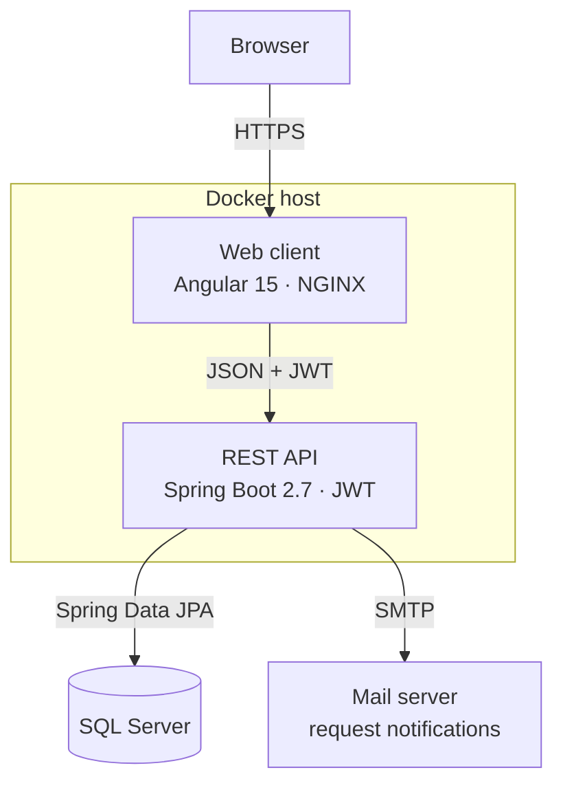
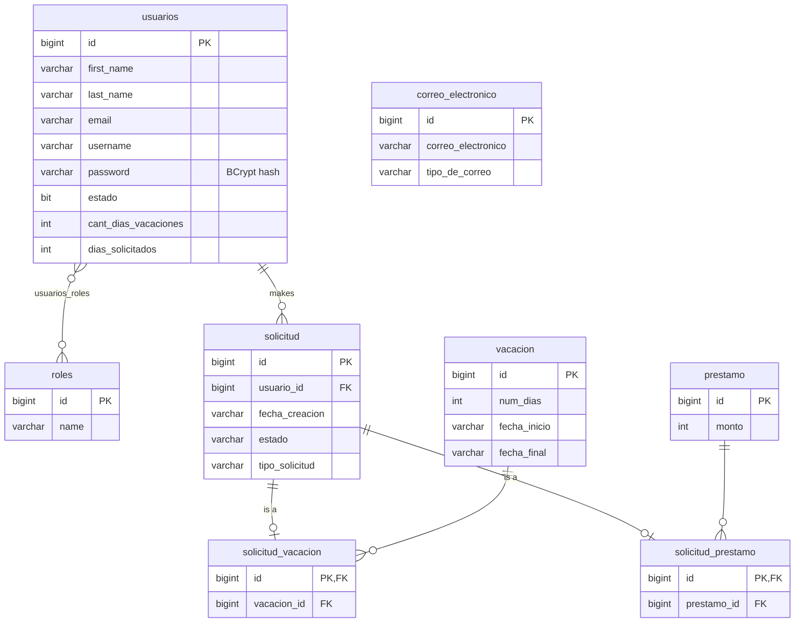

# INFO-RH

An HR self-service portal where employees request vacations and loans, and HR staff review and resolve those
requests. Built for a Costa Rican distribution company as a university capstone project (2022–2024), and
deployed on the company's own Linux server with Docker.

Company names, logos, addresses and credentials have been removed from this copy; the logo shown in the app
is a placeholder. The interface and the notification emails are in Spanish.

## What it does

**For employees**

- Request vacations; the system calculates the days from the selected dates.
- Request loans.
- Follow the status of each request and get an email when it is approved or rejected.
- Edit their profile, change their password and recover it by email.

**For HR administrators**

- Review vacation and loan requests and approve or reject them.
- Create and manage users and their roles (administrator, supervisor, user).
- Configure the system, including the mailbox that sends notifications.

## How it is built

```
backend/    REST API     Java 17, Spring Boot 2.7, Spring Security (JWT), Spring Data JPA, SQL Server
frontend/   Web client   Angular 15, TypeScript, Angular Material, Bootstrap, served by NGINX
```

- **API.** REST controllers for authentication, users, vacation requests, loan requests and configuration.
  Authentication is stateless with JWT, and passwords are stored with BCrypt.
- **Notifications.** Request changes publish events; a listener per module (vacations, loans, security) turns
  them into emails, so adding a new kind of notification does not touch the request logic.
- **Tests.** Unit tests for the services (users, roles, vacation and loan requests, date calculation,
  notifications) with JUnit 5 and Mockito.
- **Web client.** Separate dashboards for administrators and regular users, with route guards per role and an
  HTTP interceptor that attaches the token.
- **Deployment.** Each part has its own Dockerfile and Compose file. The web client reads the API address at
  container start, so the same image works in any environment.

### Architecture



### Data model

A request (`solicitud`) holds what every request shares: who made it, when, and its status. Vacation and loan
requests extend it (JPA `JOINED` inheritance) and point to their details. The schema is generated by Hibernate
from the entities.



`correo_electronico` stands alone: it stores the configured email addresses by type (for example, the administrator's).

## Running it

### Backend

Requirements: Docker, and a SQL Server database the container can reach.

```bash
cd backend
cp stack.env.example stack.env     # then fill in your own values
docker compose up --build
```

`stack.env.example` lists every variable the API reads: the database connection, the mail account and
`JWT_SECRET` (Base64-encoded). On first start the API creates the roles and a default `admin` user; change its
password after signing in.

### Frontend

```bash
cd frontend
docker compose up --build          # http://localhost:4200
```

`frontend.env` sets `API_URL`, the address of the API. For development without Docker: `npm install` and
`npm start`.

## About this repository

I led the project in a three-person team and wrote most of the backend and the web client, and set up the
Docker deployment on the company's server.

This is a cleaned-up copy of the original repositories, published without their commit history.
